# 🎓 ExamMatrix

**ExamMatrix** is a web-based **Examination Management, Seating Allocation and Invigilation System**. A university registers, uploads its students, subjects, halls and invigilators, and ExamMatrix schedules exams without clashes, seats every student away from same-subject neighbours, assigns invigilators to every hall, and lets each student find their seat in seconds.

Phase 2 turns the original browser-only app into a full-stack application with a **Node.js + Express** server, a **MongoDB** database, logins with roles, and a new **invigilator portal**.

---

# 🌐 Live Demo: <ADD-DEPLOYED-LINK-HERE>

---

## 📜 Project History

ExamMatrix was built in two phases in this same repository, so every commit from both phases is in one history.

| Phase | What it was | Where to see it |
|---|---|---|
| **Phase 1** | Frontend only (HTML, CSS, JavaScript). Data came from JSON files and was saved in the browser's `localStorage`. | Tag [`v1.0-phase1`](https://github.com/I-Manmeet/ExamMatrix/tree/v1.0-phase1) |
| **Phase 2** | Full stack: Express server, MongoDB, logins with roles, uploads, invigilator auto-assign, attendance, incidents and reports. | Branch `dev` |

Full commit history: [github.com/I-Manmeet/ExamMatrix/commits/dev](https://github.com/I-Manmeet/ExamMatrix/commits/dev)

---

## ✨ Features

### 🏛 For University Admins
* 🏛 **University Registration** — Register with a verified email and receive a unique university ID (e.g. `UNI-0001`). Each university only ever sees its own data.
* 📤 **Bulk Data Upload** — Upload **halls, subjects, students and invigilators** from files. Every file is **previewed and checked row by row** before anything is saved, and re-uploading updates existing records instead of wiping them.
* 📥 **Templates & Export** — Download a blank template for each file type, or export the saved data in the same format to edit and upload again.
* 📅 **Exam Creation** — Pick an exam name, date, time slot, subjects and halls.
* ⚠️ **Server-Side Clash Detection** — Blocks an exam if a student already has another exam at the same time, if two picked subjects share students, if a subject has already been examined, or if the halls don't have enough free seats.
* 🛡️ **Conflict-Free Seating** — No two students writing the same subject sit next to each other (front, back, left or right).
* 👥 **Invigilator Auto-Assign** — One click fills every hall with invigilators, following fixed rules. The admin can swap anyone by hand.
* 📊 **Exam Reports** — Attendance per hall, the list of absent students, and every incident reported during the exam.
* 🔑 **Invigilator Password Reset** — Give an invigilator a new temporary password. Their old logins stop working immediately.

### 📋 For Invigilators
* 🔐 **Own Login** — Log in with an invigilator ID (e.g. `INV-0001-0007`).
* 🗓 **My Duties** — See every assigned hall, date and slot, soonest first, and who else shares the hall.
* 🪑 **Hall Duty View** — The seating chart for their hall only.
* ✅ **Attendance** — Tap a seat to mark a student present or absent.
* 🚨 **Incident Reporting** — Report unfair means, unwell students, seat disputes and more, linked to the exam and hall.

### 🎓 For Students
* 🔎 **Find My Seat** — On the home page, with **no login**: enter the university ID and roll number to see the hall, row, seat, subject, date and slot of every exam.

---

## 👥 Roles at a Glance

```text
                         ┌──────────────────┐
                         │   🗄  MongoDB    │
                         └────────┬─────────┘
                                  │
                         ┌────────┴─────────┐
                         │ ⚙  Express API   │
                         └────────┬─────────┘
          ┌───────────────────────┼───────────────────────┐
          ▼                       ▼                       ▼
┌───────────────────┐   ┌───────────────────┐   ┌───────────────────┐
│ 🏛 ADMIN          │   │ 📋 INVIGILATOR    │   │ 🎓 STUDENT        │
│                   │   │                   │   │                   │
│ Upload data       │   │ My duties         │   │ Find My Seat      │
│ Create exams      │   │ Hall seat chart   │   │ (no login)        │
│ Assign duties     │   │ Attendance        │   │                   │
│ Read reports      │   │ Incidents         │   │                   │
└───────────────────┘   └───────────────────┘   └───────────────────┘
```

---

## 🛡️ Conflict-Free Seating Algorithm

The seating algorithm makes sure students writing the **same subject** never sit directly next to each other.

For every seat it checks four neighbours:

```text
             FRONT
               ↑
               │
        ┌──────┴──────┐
 LEFT ← │    Seat     │ → RIGHT
        └──────┬──────┘
               │
               ↓
             BACK
```

**How it works:**
1. Students are grouped by subject. The **largest group goes first**, because it is the hardest to place.
2. The groups are **interleaved** into one queue (A B C A B C A B A …).
3. Each student takes the **first free seat** whose four neighbours aren't writing the same subject, hall by hall, front to back.
4. Seats already used by another exam in the same slot are treated as taken.
5. If anyone can't be seated safely, the exam is **not created** and the admin is asked to add halls.

Seating now runs **on the server** (`backend/utils/seating.js`), so the result is saved once and is the same on every device.

---

## 👥 Invigilator Auto-Assign Algorithm

Auto-assign is built the same way as the seating algorithm:

| Seating | Invigilator auto-assign |
|---|---|
| Students need seats | Hall positions need invigilators |
| `fits()`: can this student sit here? | `canInvigilate()`: can this person take this hall? |
| Biggest subject goes first | Hardest position to fill goes first |
| Take the first seat that fits | Take the **least busy** person who fits |
| Unplaced students are reported | Unfilled positions are reported, with a reason |

**Rules:**
* **1 invigilator per 30 students** in a hall, and at least 1 per hall.
* Nobody invigilates a hall where **a subject they teach** is being written.
* Nobody is in **two places in the same slot**.
* At most **2 duties per day** per person.
* Nobody is assigned on a day they marked as **unavailable**.

**How it works:**
1. Work out every position, e.g. a hall with 40 students needs *#1* and *#2*.
2. After **every** assignment, pick the position with the **fewest eligible people right now** and fill it next.
3. Give it to the eligible person with the **fewest duties so far**, choosing at random on a tie, so duties are spread fairly.
4. If nobody is eligible, the position is left **unfilled with a reason** (e.g. *"No eligible invigilator: 2 teach this subject, 3 already on duty"*). A rule is never broken to fill a seat.

Once attendance has been marked for an exam, its duties are **locked**.

---

## ⚠️ Clash Detection

Before an exam is saved, the server checks it against **every exam of that university**:

```text
New exam
   │
   ├── Subject already examined?                 → ⚠️ blocked
   ├── Two picked subjects share a student?      → ⚠️ blocked
   ├── Student already in another exam
   │   at an overlapping time?                   → ⚠️ blocked
   └── Not enough free seats in the halls
       at this time?                             → ⚠️ blocked
```

---

## 🏫 Time-Aware Hall Booking

A hall is only busy for exams whose **date and time overlap**. The seats used are read from the **real saved seat maps**, so two smaller exams can share a hall in the same slot when there is room.

```text
Hall A

09:00 – 12:00 ──► Mathematics Exam
                  🔒 BOOKED

14:00 – 17:00 ──► Physics Exam
                  🟢 AVAILABLE
```

---

## 🆔 ID Formats

| What | Example | Created when |
|---|---|---|
| University | `UNI-0001` | The registration email link is opened |
| Invigilator | `INV-0001-0007` | The invigilator file is uploaded |
| Exam | `EXM-0001-0045` | An exam passes every check and is saved |
| Student | Their own college roll number | Uploaded by the admin |

IDs come from a **counter in MongoDB** that increases safely, so two requests arriving at the same moment never get the same number.

---

# 🔄 Project Workflow

```text
┌──────────────────────────────┐
│  🏛 REGISTER UNIVERSITY      │
│  Verify email → UNI- ID      │
└──────────────┬───────────────┘
               ▼
┌──────────────────────────────┐
│  📤 UPLOAD DATA              │
│  Halls → Subjects →          │
│  Students → Invigilators     │
│  Preview → Confirm           │
└──────────────┬───────────────┘
               ▼
┌──────────────────────────────┐
│  📅 CREATE EXAM              │
│  Date • Slot • Subjects •    │
│  Halls                       │
└──────────────┬───────────────┘
               ▼
┌──────────────────────────────┐
│  ⚠️ CLASH CHECKS (server)    │
└──────────────┬───────────────┘
               ▼
┌──────────────────────────────┐
│  🛡️ CONFLICT-FREE SEATING    │
│  saved in MongoDB            │
└──────────────┬───────────────┘
               ▼
┌──────────────────────────────┐
│  👥 AUTO-ASSIGN INVIGILATORS │
│  admin can swap anyone       │
└──────────────┬───────────────┘
        ┌──────┴───────┐
        ▼              ▼
┌───────────────┐ ┌───────────────┐
│ 📋 INVIGILATOR│ │ 🎓 STUDENT    │
│ My duties     │ │ Find My Seat  │
│ Attendance    │ │               │
│ Incidents     │ │               │
└───────┬───────┘ └───────────────┘
        ▼
┌──────────────────────────────┐
│  📊 ADMIN REPORTS            │
│  Attendance • Absentees •    │
│  Incidents                   │
└──────────────────────────────┘
```

### 🎯 In Simple Terms

> **A university registers → uploads its data → creates exams → the server checks clashes and seats everyone → invigilators are assigned → students find their seats → invigilators mark attendance and incidents → the admin reads the report.**

---

## 🛠️ Technologies Used

**Frontend**
* HTML5, CSS3, JavaScript
* Fetch API through one shared helper (`frontend/js/api.js`)

**Backend**
* **Node.js** with **Express 5**
* **MongoDB Atlas** with **Mongoose** (schemas, validation, `ref` + `populate()`)
* **JWT** login tokens and **bcrypt** password hashing
* **Multer** for file uploads, **xlsx** for spreadsheets
* **Nodemailer** for verification and password-reset emails
* **Helmet** and **CORS** for security headers and cross-origin access
* **EventEmitter** + **fs** activity log (`backend/logs/activity.log`)
* **dotenv** for settings, **nodemon** for development
* Node's built-in test runner (`node --test`)

**Tools**
* Git & GitHub (feature branches, Conventional Commits, pull requests)
* Postman
* Render (deployment)

---

## 📁 Folder Structure

```text
ExamMatrix/
├── backend/
│   ├── config/          database connection
│   ├── controllers/     request logic for each route
│   ├── middleware/      login + role checks, ownsDuty, uploads, errors
│   ├── models/          Mongoose schemas
│   ├── routes/          URL list for each part of the API
│   ├── utils/           seating, clash checks, auto-assign, parsers, events
│   ├── tests/           automated tests
│   ├── sample-data/     sample files to upload
│   ├── scripts/
│   ├── server.js
│   └── .env.example
├── frontend/
│   ├── css/
│   ├── js/
│   └── *.html           one page per screen
├── assets/screenshots/
└── index.html           redirects to frontend/
```

---

## 🔌 API Overview

All routes start with `/api`. Every reply is JSON: `{ data: ... }` on success, `{ error: "message" }` on failure.

| Area | Method & path | Who |
|---|---|---|
| Health | `GET /health` | public |
| Register | `POST /universities` · `POST /universities/verify-email` · `POST /universities/resend-verification` | public |
| Password | `POST /universities/forgot-password` · `POST /universities/reset-password` | public |
| Login | `POST /auth/login` · `GET /auth/me` · `POST /auth/logout` | public / logged in |
| Halls | `GET` `POST /halls` · `GET` `PUT` `DELETE /halls/:id` | admin |
| Uploads | `GET /uploads/:type/template` (public) · `GET /uploads/status` · `GET /uploads/:type/export` · `POST /uploads/all/preview` · `POST /uploads/all/confirm` · `POST /uploads/:type/preview` · `POST /uploads/:type/confirm` | admin |
| Exams | `GET /exams` · `GET /exams/options` · `GET /exams/:examId` · `POST /exams/check` · `POST /exams` · `DELETE /exams/:examId` | admin |
| Duties | `GET` `PUT` `DELETE /exams/:examId/duties` · `POST /exams/:examId/duties/auto` | admin |
| Invigilators | `GET /invigilators` · `GET /invigilators/:invId` · `POST /invigilators/:invId/reset-password` | admin |
| My duties | `GET /invigilators/me/duties` · `GET /invigilators/me/duties/:dutyId` | invigilator |
| Hall duty | `PUT /exams/:examId/hall/attendance` · `POST /exams/:examId/hall/incidents` | invigilator on that duty |
| Reports | `GET /reports/:examId` | admin |
| Find My Seat | `GET /public/seat?uni=UNI-0001&roll=24AI1001` | public |

---

## 🚀 Getting Started

### 1. Clone the repository
```bash
git clone https://github.com/I-Manmeet/ExamMatrix.git
cd ExamMatrix
```

### 2. Set up the backend
```bash
cd backend
npm install
cp .env.example .env
```

Fill in `.env`:

| Key | What it is |
|---|---|
| `MONGO_URI` | MongoDB Atlas connection string |
| `JWT_SECRET` | Any long random string |
| `PORT` | `5001` (5000 is used by AirPlay on Mac) |
| `FRONTEND_URL` | Where the frontend runs, e.g. `http://127.0.0.1:5500/frontend` |
| `SMTP_HOST`, `SMTP_PORT`, `SMTP_USER`, `SMTP_PASS`, `MAIL_FROM` | Email account for verification and reset emails |
| `DNS_SERVERS` | Only if you see `querySrv ECONNREFUSED`, e.g. `8.8.8.8,1.1.1.1` |

Start the server:
```bash
npm run dev
```
It runs on `http://localhost:5001`. Check `http://localhost:5001/api/health`.

### 3. Run the frontend
Open the repo in **VS Code** and start **Live Server** from the root `index.html`. It redirects to `frontend/index.html`.

### 4. Run the tests
```bash
cd backend
npm test
```

### 5. Try it
1. Register a university and open the link in the email.
2. Log in as the admin and upload the files in `backend/sample-data/`.
3. Create an exam, then auto-assign invigilators.
4. Log in as an invigilator with an `INV-` ID and the temporary password from the upload.
5. Look up a roll number with **Find My Seat** on the home page.

---

## 🔐 Security

* Passwords are stored as **bcrypt hashes**, never as plain text.
* **JWT** tokens carry only the user's ID, role and university.
* Every request is limited to the logged-in user's **own university**.
* Invigilators can only open, mark and report on **their own duties** (`ownsDuty` middleware).
* Repeated wrong logins are **temporarily locked**.
* Resetting a password **ends old sessions**.
* Find My Seat only returns seat details, never names or other student data.

---

# ⭐ Project Highlights

### 🏠 Home Page & Find My Seat
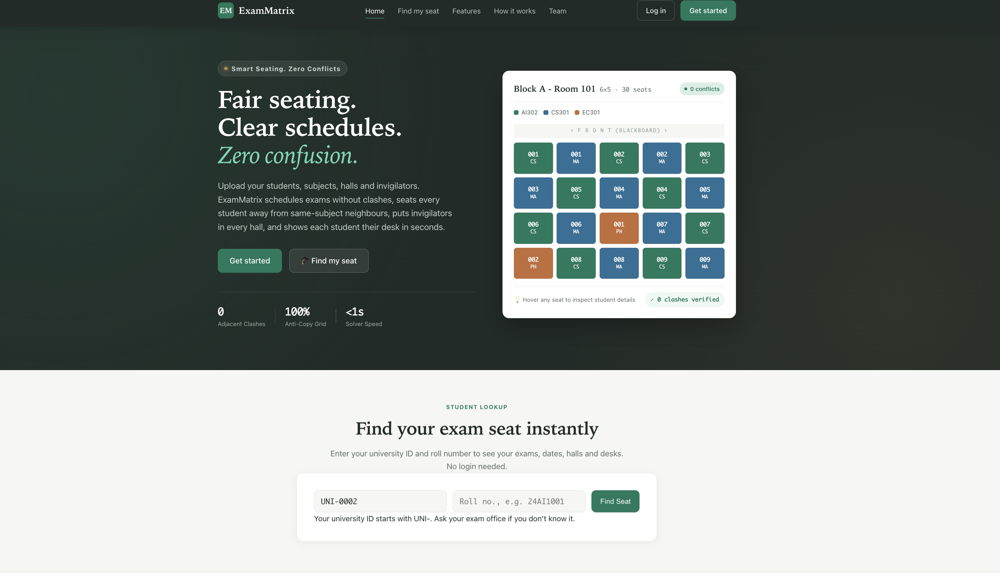
<br><br>
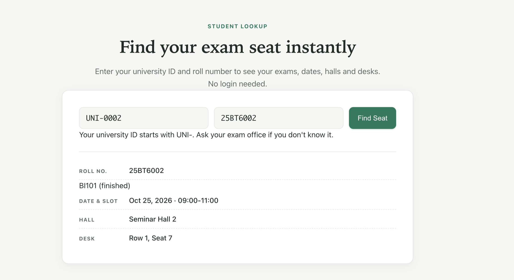

---

### 🏛 Register University & Login
<table>
  <tr>
    <td align="center">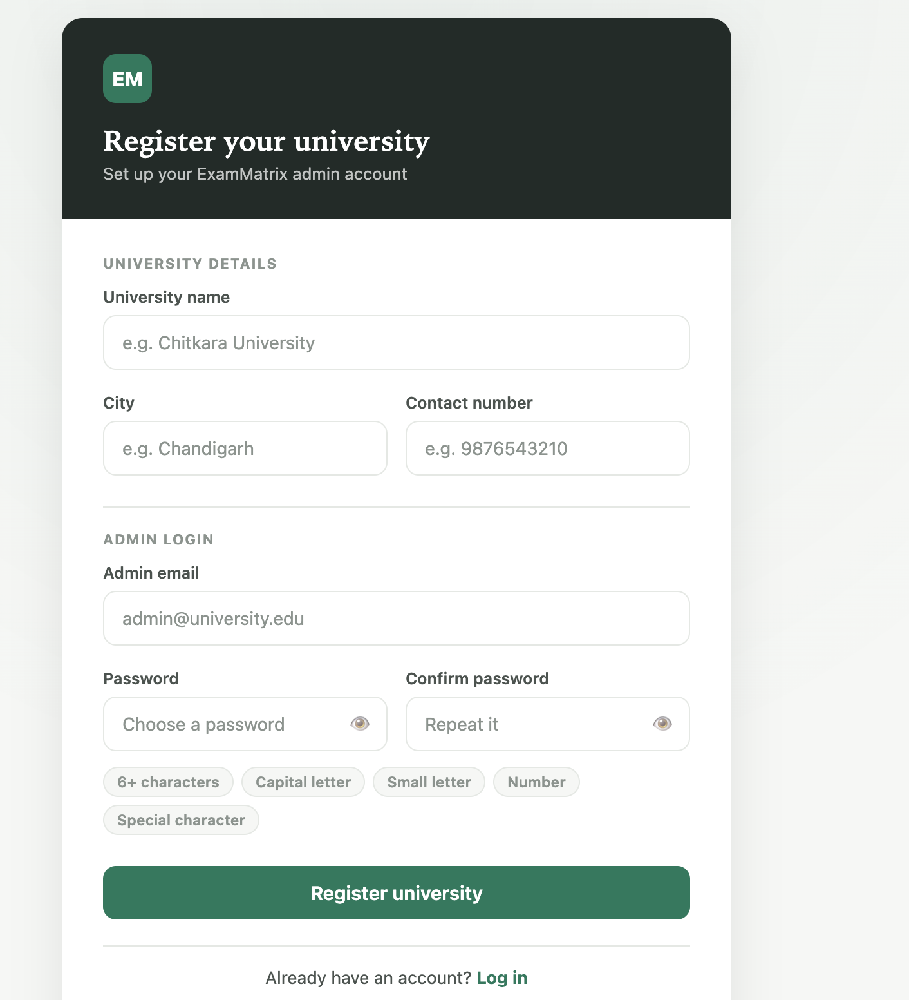<br>Register</td>
    <td align="center">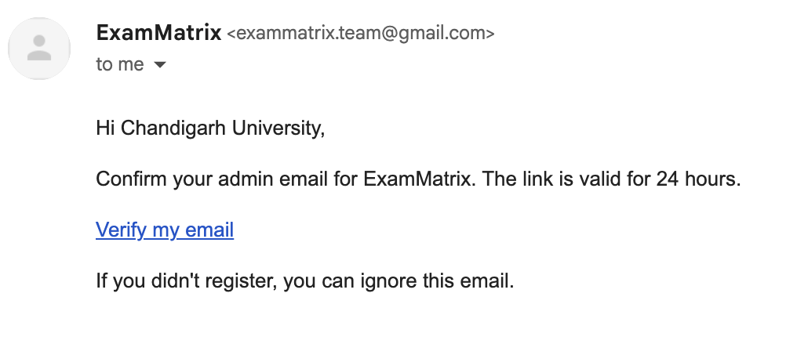<br>Email verified</td>
    <td align="center">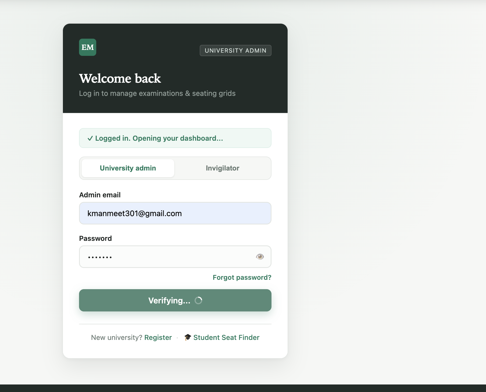<br>Login</td>
  </tr>
</table>

---

### 📊 Admin Dashboard
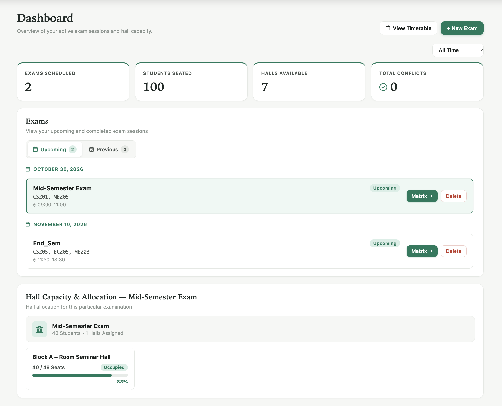

---

### 📤 Upload Data
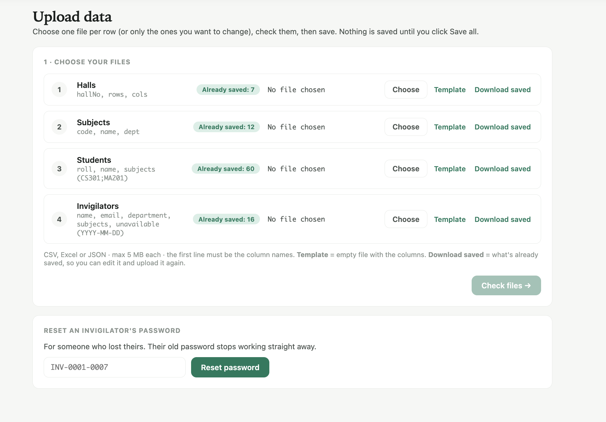

---

### 📅 Exam Creation & Hall Allocation
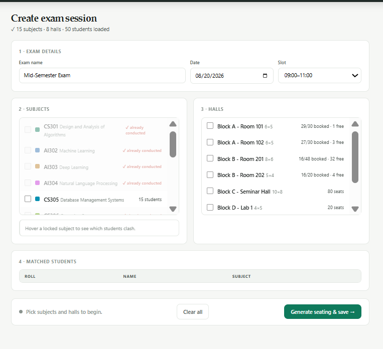

---

### 🛡️ Conflict-Free Seating
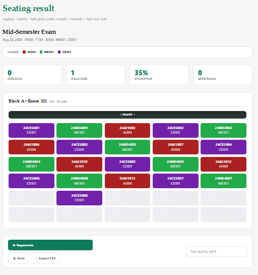

---

### 👥 Assign Invigilators
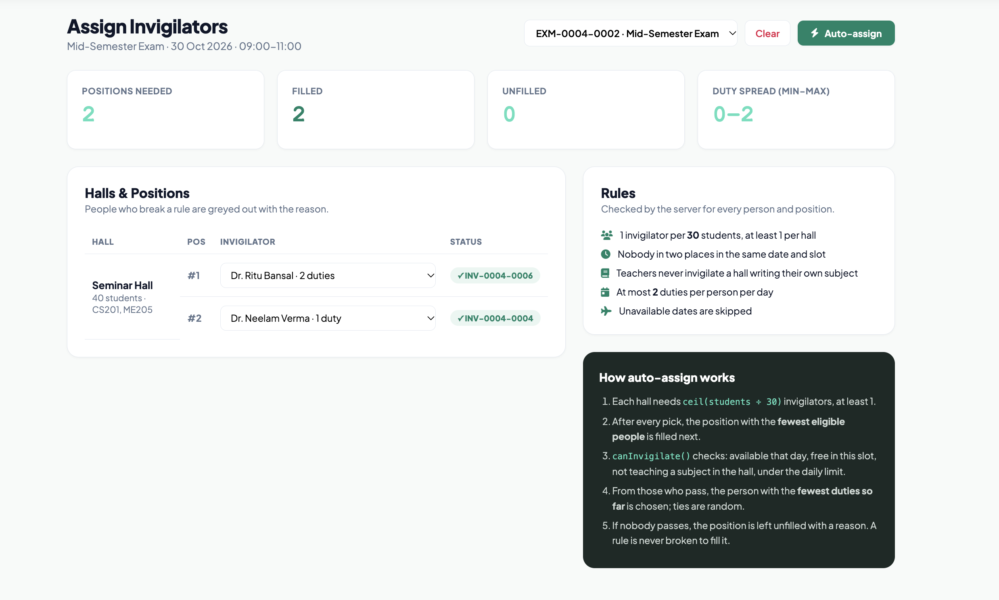

---

### 📋 Invigilator Dashboard
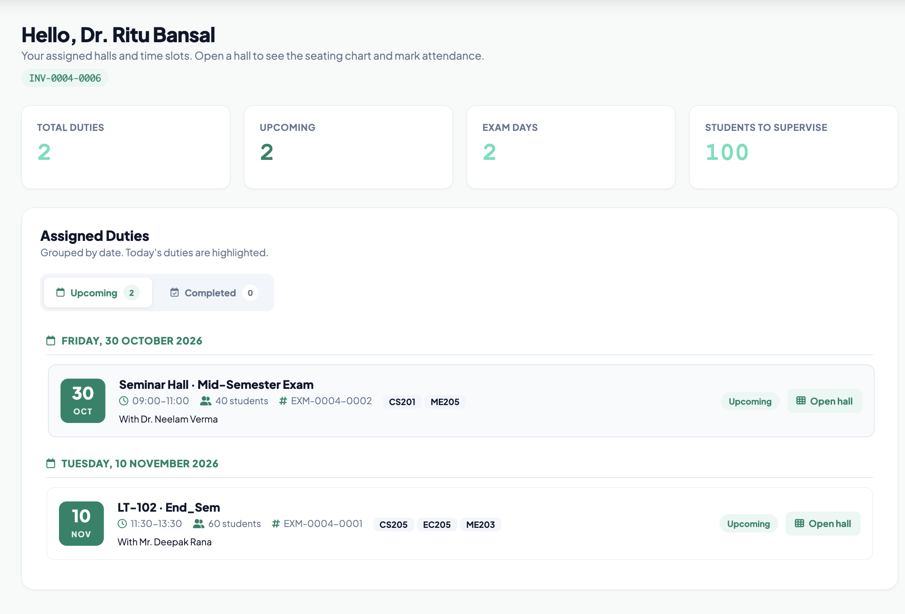

---

### ✅ Hall Duty: Attendance & Incidents
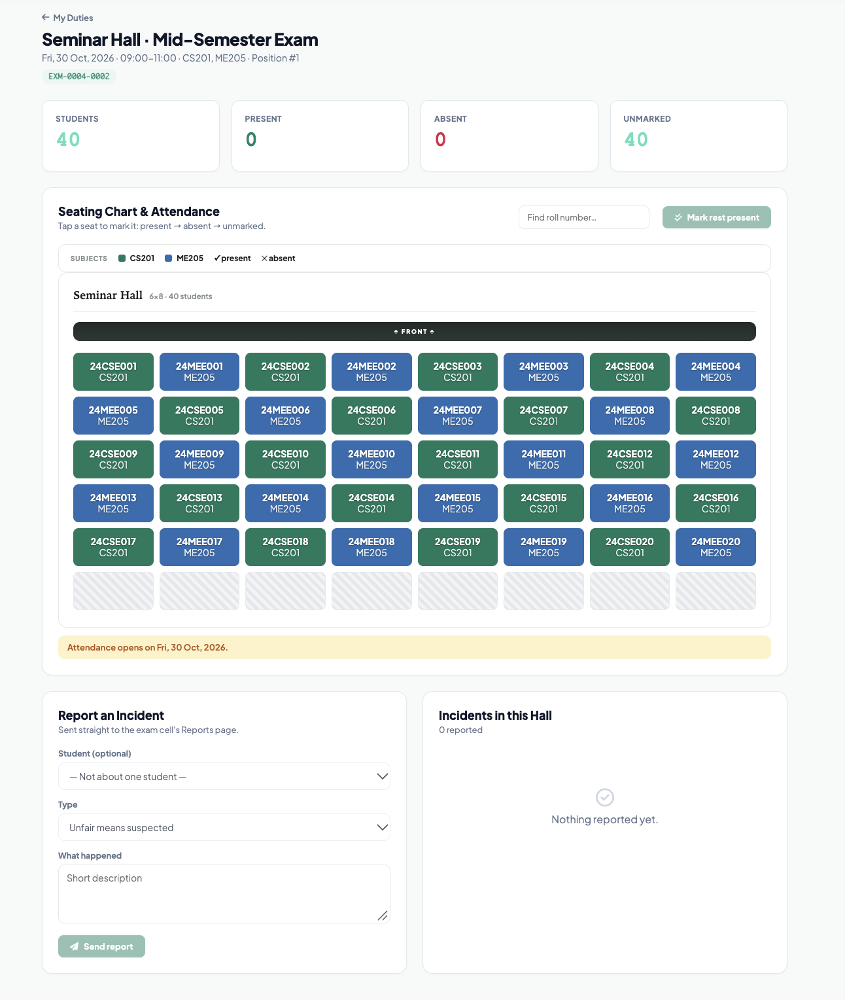

---

### 📊 Exam Reports
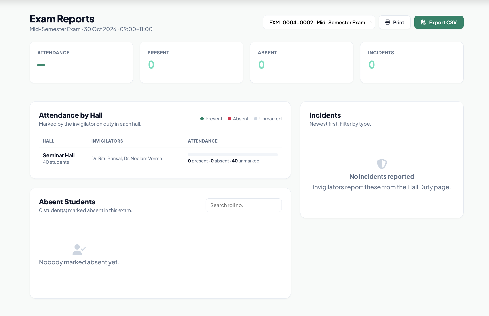

---

### 📅 Timetable
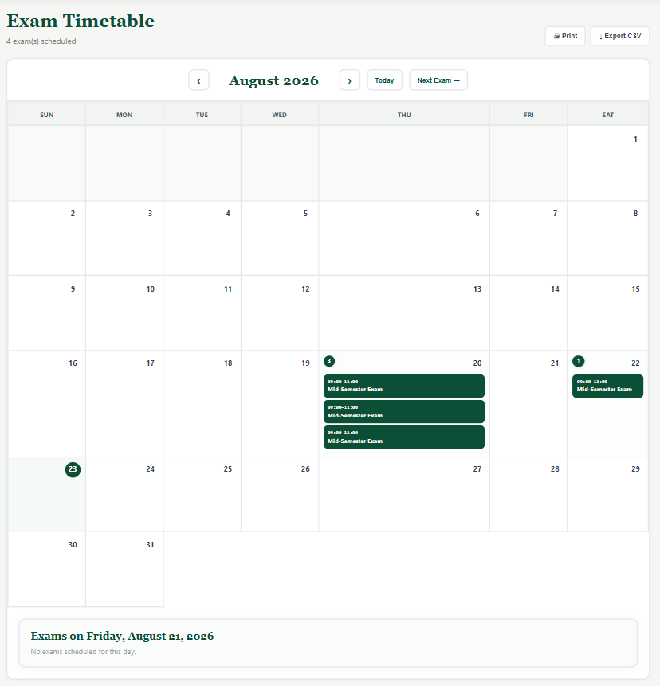

---

# 🔮 Future Improvements

* **📱 Student Dashboard** — A personal page with each student's timetable, seats and exam reminders.
* **🧠 Smarter Seating & Assignment** — Backtracking, so a hall left unfilled by an early choice can still be filled.
* **📧 Duty Notifications** — Email invigilators when a duty is assigned or changed.
* **📆 Automatic Timetabling** — Suggest dates and slots for all exams at once, with no clashes.
* **📷 Incident Photos** — Attach a photo to an incident report.

---

# 👥 Contributors
| 🟠 | **Manmeet** — [@I-Manmeet](https://github.com/I-Manmeet) 
| 🟢 | **Jiya** — [@JiyaJindal3210](https://github.com/JiyaJindal3210) 
| 🔵 | **Anupam** — [@Anupamshraddha](https://github.com/Anupamshraddha) 
